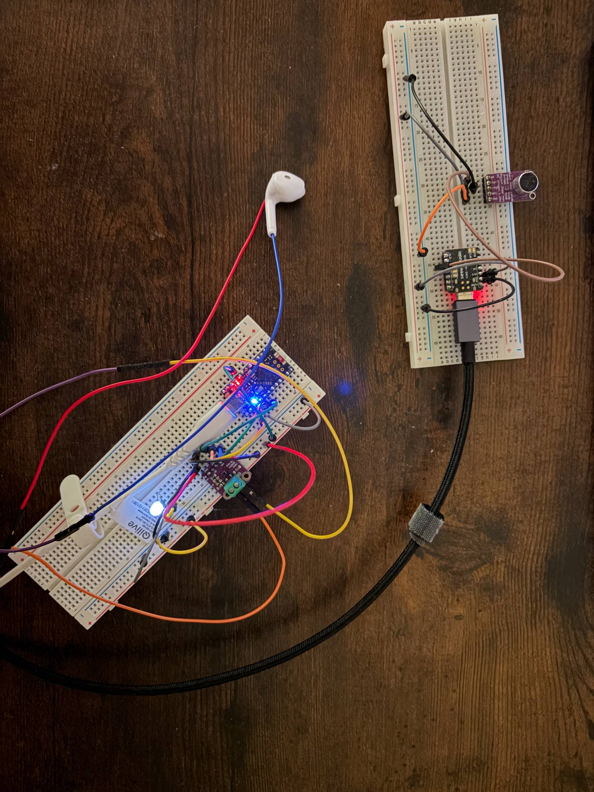
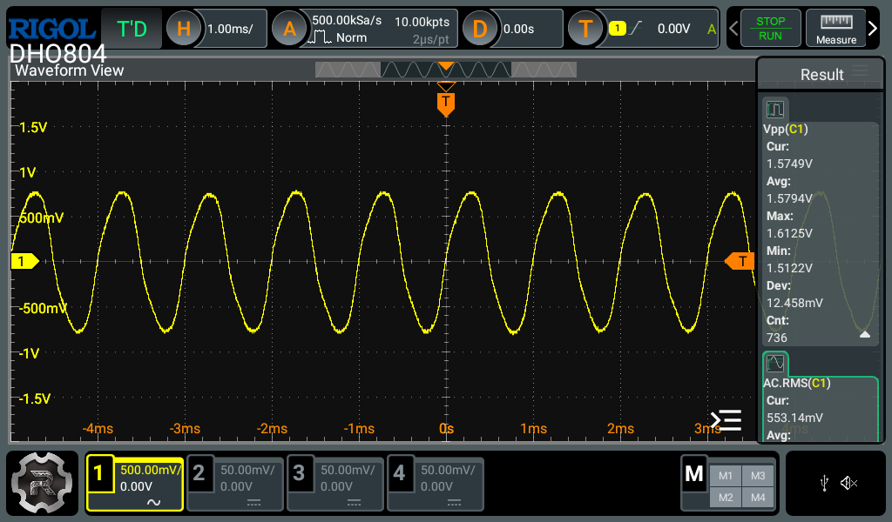
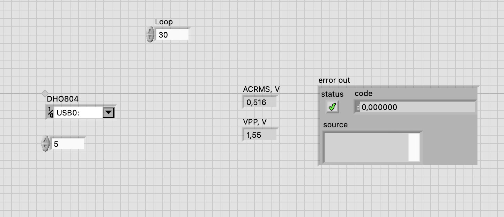

# RF-Audio-Device
Second prototype that broadens functionality with RF signal transmission

## Used materials
Microphones
> MAX9814

Amplifiers
> MAX98357A

 Load
> Headphone driver

Microcontrolles
> nRF52840 Pro Micro
> 
> nRF52840 XIAO Seeed

 Power
> 2 USB-C Connections

 SMD Components
> White LED
> 
> 330 Ohm Resistor

Jumpwires/Dupontwires

## Used tech
Oscilloscope DHO804

Solder Air Station Yihua 948D

LabView 2026 v26

VS Studio Code

## Connection
1. USB-C Connections - MAX9814 - XIAO Seeed Microcontroller(PTX)
2. USB-C Connections - Pro Micro Microcontroller(PRX) - MAX98357A - Headphone driver
> Circuit - 
> 
> Amplified sound is grainy, more distinct with higher pitches and closer location. Stable distance between RF modules is ~1m.

## Tests and measurements 
TC-01
> Goal is to check the behaviour of microphone with 1Khz stable sound wave within 30cm proximity.

CSV file shows results for 30 consequent measurements - VPP and ACRMS.
LabView files is presented accordingly.

## Conclusions
Circuit works and shows possibilities for RF signal transmissions as an alternative path of components placement instead of classic solutions; 
